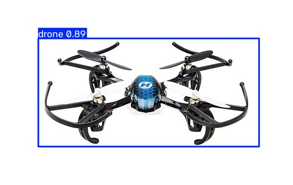
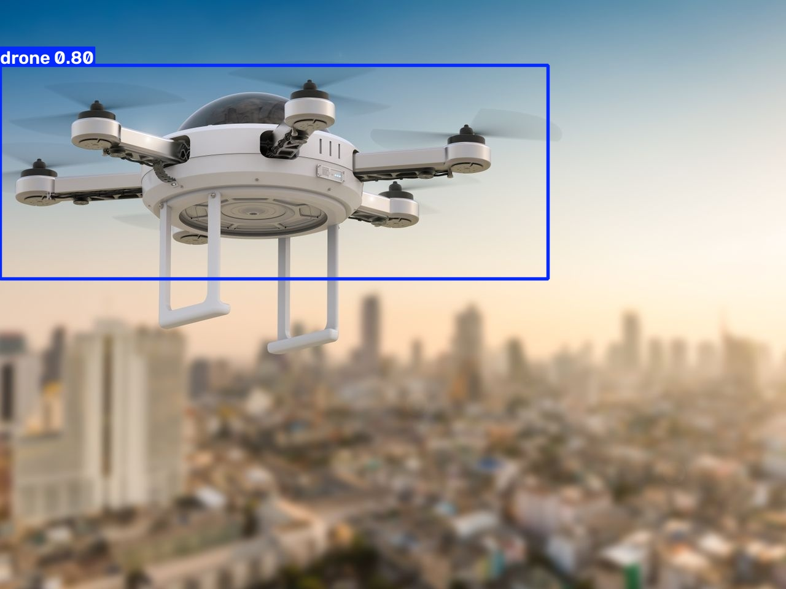

# Drone Detection System (YOLOv8)

Single-class drone detector built by fine-tuning YOLOv8n (Ultralytics). The repo ships the trained
weights (`models/drone_best.pt`, 6 MB), so you can run detection on images and videos right after
cloning. The dataset is not included (see [Dataset](#dataset)).

| Input | Detection |
|---|---|
|  |  |

A short annotated clip is in [`assets/demo_detection.mp4`](assets/demo_detection.mp4).

## Measured results

Evaluated with `python scripts/evaluate.py` on the 272-image validation split (296 drone instances),
imgsz 416, Apple M-series (MPS/CPU):

| mAP@0.5 | mAP@0.5:0.95 | Precision | Recall |
|---|---|---|---|
| 0.948 | 0.684 | 0.975 | 0.905 |

The training log (`results.csv`, 50 epochs, YOLOv8n, batch 8, imgsz 416) ended at mAP@0.5 = 0.954 /
mAP@0.5:0.95 = 0.693; the small difference to the re-run above is expected evaluation variation.
Validation inference on this machine took about 9 ms per image (plus about 7 ms post-processing);
video annotation ran at roughly 28 FPS on Apple silicon. These are single-machine numbers, not a
general benchmark. The model has one class (`drone`), trained on one Kaggle dataset, so
generalisation to other scenes/sensors is untested; on one stock test video it found drones in only
5 of 90 frames.

## Setup

```bash
git clone https://github.com/parvashah29/Drone-Detection-System.git
cd Drone-Detection-System
python3 -m venv venv && source venv/bin/activate   # Windows: venv\Scripts\activate
pip install -r requirements.txt
```
Tested with Python 3.12 on macOS arm64. Devices are chosen automatically (CUDA, Apple MPS, else CPU);
override with `--device`.

## Usage

All scripts accept `--help`. Weights default to `models/drone_best.pt` (override with `--weights`).

```bash
# images: a file or a folder -> annotated copies in detection_results/
python scripts/inference.py assets/pred_0071.jpg --conf 0.25

# video (or `webcam`) -> output/videos/<name>_detected.mp4; add --show for a live window
python scripts/video_inference.py path/to/video.mp4 --conf 0.45

# evaluate on the val split (needs the dataset)
python scripts/evaluate.py

# train (needs the dataset); 50 epochs by default
python scripts/train.py --epochs 50 --batch 8 --imgsz 416

# optional: split a flat folder of image+label pairs into train/val (80/20)
python scripts/organize_dataset.py --source drone_dataset_yolo/dataset_txt
# optional: resize a folder of images
python scripts/preprocess.py in_dir out_dir --size 416
```
Live windows are only opened with `--show` and only when a display is available, so scripts run
headless over SSH/CI. Missing weights, dataset, or unreadable videos give a clear error message.

## Dataset

Not committed (about 400 MB). The original data came from a Kaggle drone-image dataset in YOLO
format (one class, `drone`). Place it so that the layout is:

```
drone_dataset_yolo/
├── train/{images,labels}/   # *.jpg + same-named YOLO *.txt  (class 0 x y w h, normalised)
└── val/{images,labels}/
```
The version used here had 1087 train and 272 val images. If you only have a flat folder of
images + labels, put it in `drone_dataset_yolo/dataset_txt/` and run `scripts/organize_dataset.py`.
`data.yaml` points at `drone_dataset_yolo/` relative to the project root.

## Project layout

```
models/drone_best.pt     trained weights (shipped)
assets/                  sample outputs
scripts/                 common.py, train.py, evaluate.py, inference.py, video_inference.py,
                         organize_dataset.py, preprocess.py
tests/                   pytest suite (logic + smoke tests that skip without weights/dataset)
data.yaml  requirements.txt  requirements-dev.txt
```

## Tests

```bash
pip install -r requirements-dev.txt
pytest
```

## Limitations / ideas

- Single class; no tracking; accuracy outside the training distribution is unmeasured.
- Ideas: export to ONNX/CoreML, add tracking, multi-class drone types.

## License

MIT, see [LICENSE](LICENSE). YOLOv8 by Ultralytics (AGPL-3.0) is a dependency.
